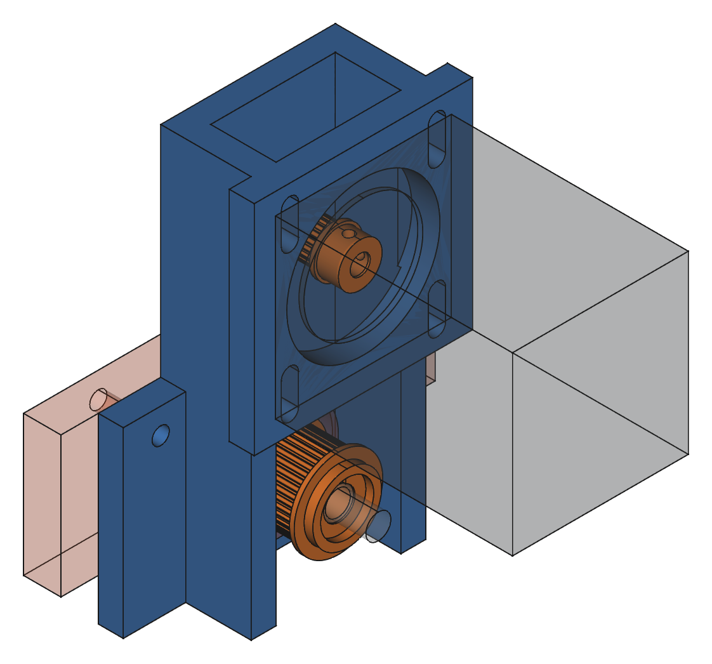

# wen-33013-cnc

Converting a **WEN 33013** benchtop mill to CNC under LinuxCNC.

```
LinuxCNC (Raspberry Pi 4 "lcnc", PREEMPT_RT kernel)
   |
   |-- SPI ------ motion0  (RP2040)  PIO step/dir -> DM542T -> NEMA 23
   |                                 SPI1 -> 14-bit belt encoders
   |
   '-- USB ------ pendant  (RP2040)  DWIN T5UIC1 panel (Ender 3 V2 screen)
```

| | |
|---|---|
| Base machine | WEN 33013 - a rebadged **Sieg X2D**, the large-table X2 - R8 spindle, 100-2500 RPM, 130 lb |
| Travels | X 300 mm, Y 130 mm, Z 177.8 mm |
| Drives | NEMA 23 on DM542T; X belted **1:1** onto the **stock** lead screw (ADR-0009, ADR-0011) |
| Resolution | X and Y 4032 steps/mm (0.25 um) at 32x; X runs 16x -> 2016 (0.50 um) |
| Feedback | 14-bit absolute encoders, GT2 belt driven, 409.6 counts/mm (2.44 um) |
| Controller | LinuxCNC 2.9.8 on Pi 4, 1 kHz servo thread |

> **Other X2D owners:** the WEN 33013 is a Sieg X2D clone, so the castings,
> dovetails and end mounts are shared with every other X2D rebadge. The
> measured machine dimensions in `hardware/mechanical/` should be a strong
> starting point for yours - though clone-to-clone casting variation is real,
> so measure before you cut. Off-the-shelf X2D ballscrew kits exist and use
> **SFU1204** (12 mm, 4 mm lead) on the wide-table X axis.

## The idea

One file, `machine/wen33013.toml`, describes the machine. Everything else is
generated from it:

```
machine/wen33013.toml ──┬──► linuxcnc/configs/wen33013/wen33013.ini
                        ├──► firmware/pico-spi/include/machine_config_*.h
                        └──► pi/provision/99-cnc-nodes.rules
```

That means the scale LinuxCNC commands and the scale the firmware applies
cannot drift apart, because a test asserts they are the same number. When they
do drift, nothing errors - the machine just cuts everything at the wrong size.

## Quick start

```bash
make test        # unit tests (fast, no hardware)
make check       # validate the machine against physical limits
make gen         # regenerate everything
make verify      # fail if generated files are stale
make all         # verify + lint + test, before committing
```

No `make` (e.g. Windows)? Same targets via the stdlib task runner:

```bash
python tasks.py all
```

No runtime dependencies - stdlib only, so it runs on a bare Pi. `pytest` and
`ruff` are dev-only.

## Layout

| Path | What |
|---|---|
| `machine/` | the single source of truth |
| `tools/machinegen/` | model, constraints, generators |
| `linuxcnc/` | generated INI, hand-written HAL glue, HAL components |
| `firmware/pico-spi/` | RP2040 SPI slave + PIO step generation |
| `ui/` | SVG -> DWIN panel compiler, screen designs |
| `pi/provision/` | how the Pi is built, from blank card to running |
| `hardware/electrical/` | wiring, DIP settings, BOM |
| `hardware/mechanical/` | printed and machined parts, built from scripts |
| `docs/decisions/` | ADRs - why things are the way they are |
| `docs/commissioning/` | procedures for bringing the machine up safely |
| `tests/` | `unit` (always), `integration` (needs LinuxCNC), `hardware` (needs the mill) |

## The mechanical side

Parts are scripts too. The X axis is driven by a NEMA 23 through a 2:1 GT2
belt onto the **stock** lead screw, bolted to the mill's existing bearing-seat
plate - nothing on the machine is drilled or modified.



The pulley tooth counts live in `machine/wen33013.toml`, not in the CAD,
because they decide `steps_per_mm`. Change the reduction and the pulley, the
LinuxCNC INI and the firmware header all move together.

```bash
cd hardware/mechanical/x-drive
FreeCADCmd build.py && FreeCADCmd verify.py && FreeCADCmd export.py
```

Nothing is checked by eye: `build.py` fails on interference between parts,
`verify.py` probes all 40 tooth grooves and checks they sit at the computed
root and land radii, and `export.py` refuses a mesh that is not solid,
non-manifold, or self-intersecting. See
[`hardware/mechanical/`](hardware/mechanical/).

## Safety

The E-stop is **hardwired** and kills driver power through a physical
contactor. Software only observes it. Realtime and safety duties (step
generation, limits, probing) are confined to the SPI node; USB is for the
screen, which is never in the stop path. These rules are enforced by
`tools/machinegen/constraints.py`, not just documented.

## Status

Early, and honest about it.

| | |
|---|---|
| Machine model, generators, constraint checks | working, tested |
| Pi 4 provisioned and on the network | done |
| Pendant panel brought up | done |
| X end housing + belt drive | designed and asserted; bore fit not yet printed |
| RP2040 SPI firmware | not started |
| Y and Z drives | not started |

**Nothing here has cut metal yet.** Values marked `PROVISIONAL` in
`machine/wen33013.toml` are starting points until commissioning confirms
them. The X screw's lead is no longer one of them: the SIEG X2D manual
documents it as 0.0625in (1.5875 mm) per turn, which replaced a guessed
2.0 that was wrong by 26%. Confirm it anyway - ten turns of X must move the
table 15.875 mm.

Z is the last un-sourced scale in the file, and it is modelling the wrong
mechanism: the X2 Z axis is a rack and pinion with a fine-feed worm, not a
lead screw.

See `CHANGELOG.md` for what has actually been done, and `AGENTS.md` for the
working standards.

## Licensing

Mixed on purpose: `tools/`, `ui/` and `firmware/` are MIT (clean-room);
`linuxcnc/components/` is GPL-2.0 because it links LinuxCNC; the DWIN pendant
driver is GPL-3.0. See `AGENTS.md` section 7 before moving code between them.
