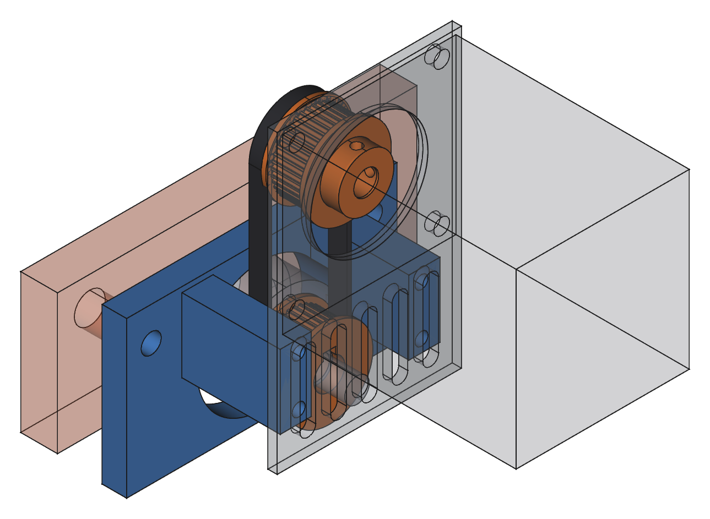

# X belt drive, on the stock plate

The stock bearing-seat plate, its 8200 thrust bearing and the M8 nut all
stay. This bolts to the same two M6 holes, puts a printed 40T pulley where
the handwheel was, and carries a bought NEMA 23 plate. **No bore, no
bearings, no spacers, no circlip.**



```bash
cd hardware/mechanical/x-belt
FreeCADCmd build.py && FreeCADCmd export.py
```

| | |
|---|---|
| Bracket | 40 × 88 × 51, **38.3 cm³** |
| Screw pulley | 40T, keyed, 14 wide, **5.7 cm³** |
| Motor pulley | 40T, 8 mm bore, grub screws, **7.4 cm³** |
| Reduction | 1:1 → 2016 steps/mm |
| Belt | 2GT, 6 mm, 200 mm / 100T, C = 60.00 |

Against 104 cm³ for the x-end housing and 144 for the first bracket.

## What sets the pulley's width

Everything has to live on the stub the stock plate leaves exposed:

```
plate face 0 ....... boss face 16 | free land ..26 | M8 thread ..39
                     pulley 16..30          washer+nut to 38.1
```

The screw pulley is **14 mm** wide, and the 6 mm belt is not what decides
that. Two things do, and they pull opposite ways:

- the **washer and nut** must finish before the thread runs out at 39
- the **motor plate** must clear the end of the thread, which sticks 3.9 mm
  past the nut, so it sits at X 40 and fixes the motor's shaft tip at 22

That second one is what widens the seat. The teeth overlap is
`(16 + 1.5 + seat) − 22 = seat − 4.5`, so a 6 mm belt needs a seat of at
least 10.5. At 11 the overlap is **6.5 mm** and the nut finishes with 0.9 mm
of thread to spare. An M8 **jam nut** instead of a full one buys 3.4 mm if
you would rather have the margin there.

## Why the stock plate is back

[ADR-0010](../../../docs/decisions/0010-x-end-housing-replaces-the-stock-plate.md)'s
housing is parked, not abandoned - the stock single thrust bearing really is
the X backlash, and a preloaded pair really is the fix. But the housing
printed with its **bore sealed at both ends** (Ø20 lip, Ø22 web, Ø26
bearing), and getting it moving on stock parts first is worth more than
getting it perfect.

## What is asserted

Every one of these exists because something got past the previous set:

| | |
|---|---|
| clash | **all 28 pairs**, not a hand-written list. The list missed the screw running through the motor plate |
| screw access | all 6, M6 and M5. Two earlier brackets were unassemblable |
| belt keep-out | nothing within 2 mm, all the way round the loop |
| tooth overlap | the two pulleys must share at least the belt's width |
| overhang | ≤ 300 mm², and 45° counts as supported |
| mesh | solid, manifold, no self-intersections |

## Printing

Backplate flat on the bed, building outboard. Supports off - the only thing
in the air is 28 mm² at the bore's chamfer. Pulleys bore-vertical.

5-6 perimeters, 40-50% infill, PETG or ASA. The pulleys want perimeters
most: the thinnest section is root-to-keyway-roof.

## Bill of materials

| Qty | Item | Note |
|---|---|---|
| 1 | Bracket | `stl/Bracket.stl` |
| 1 | 40T pulley, keyed | `stl/Pulley_40T.stl` |
| 1 | 40T motor pulley, 8 mm bore | `stl/MotorPulley_40T.stl`, 2× M4 grub |
| 1 | 2GT closed loop, **6 mm**, 200 mm / 100T | buy |
| 1 | NEMA 23 plate, T3 × 60 × 96.5 | yours |
| 2 | **M6 × 30** socket cap | 8 bracket + 12 plate + ~10 thread |
| 4 | M5 × 12 | into the bracket's bosses, through the plate's slots |
| 1 | M8 nut + washer | **reuse the stock ones** off the handwheel |

The key stays in. The pulley is keyed and the nut clamps it, exactly as the
handwheel was retained.
