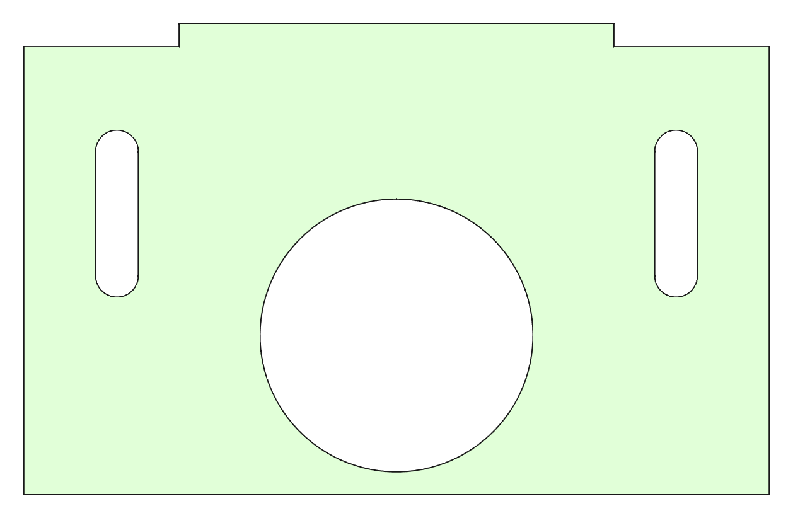
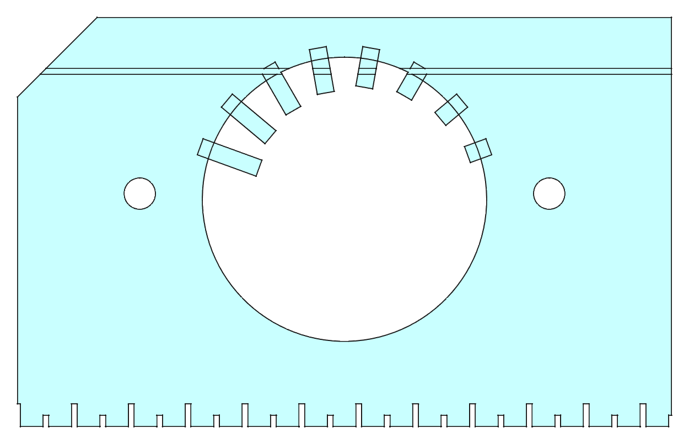

# X-axis belt drive

A NEMA 23 driving the **stock** X lead screw through a 2:1 GT2 belt, bolted to
the mill's existing X-axis bearing-seat plate. Nothing on the machine is
modified or drilled: the 40T pulley takes the place of the dial and handwheel
on the screw's existing keyed stub, and the bracket is clamped by the same two
M5s that already hold the plate on - just longer ones.


| | |
|---|---|
| Reduction | 2:1 (40T screw / 20T motor), from `machine/wen33013.toml` |
| Belt | 2GT, 15 mm wide, 200 mm closed loop (100T) |
| Centre distance | 69.71 mm, motor directly above the screw |
| Bracket | 37 × 96 × 129 mm, 131 cm³ |

## Status

**The fit coupon fits the machine** (2026-11-19). That confirms, physically:
the 72 mm bolt pitch, the 15.7 mm bolt-line offset, the bore clearing the
boss, and the backplate sitting flat on the plate face.

It does **not** confirm the side walls clear the boss. The coupon is only
the bracket's first 4 mm; the walls start at 8 and the boss stands 16 proud,
so that clearance is asserted in `build.py` and not yet fitted. Watch it
when the full bracket goes on.

## The screw end it fits

Measured 2026-11-19, and corroborated by the WEN parts list in three places:

```
   |<-- 18.8 -->|<-- 13.0 -->|
   |   d10 land  |  M8 thread |
   +=============+~~~~~~~~~~~~+
   ^ 4 x 4 x 16 key, standing 1.5 proud
   ^ runs in an 8200 thrust bearing (10 x 26 x 11) in the cast seat
```

- `#13 Ball Bearing, 8200` → a **10 mm** bore, matching the Ø10 land.
- `#14 Washer, M8` + `#15 Nut, M8` → the thread beyond it.
- `#2-1 Key, 4 × 16` → a 4 × 4 key sunk 2.5 mm in a Ø10 shaft stands 1.5 proud.

## How it is held on

The bore runs 19.3 mm deep - 0.5 past the end of the Ø10 land - so the nut
recess bottoms on the *thread*, not on the shaft's own shoulder. The stock M8
washer and nut then clamp the pulley back against the bearing seat exactly the
way they clamped the handwheel. Washer and nut finish at 27.4 mm with 4.4 mm
of thread to spare.

There is **no grub screw**: the hub boss wall is only 2.5 mm, and putting one
through the belt seat would chew up three teeth. Torque goes through the key,
the nut holds it on. Use a nyloc or a jam nut.

## What locates it

The bracket's **register bore drops over the bearing boss**, not over
the bolts. Two M5s on one horizontal line cannot resist the motor hanging
outboard - that couple has no lever arm between them - so the boss takes it
and sets the pulleys concentric at the same time.

The motor sits directly above the screw so belt tension acts straight down
through the bolt pattern's vertical centreline: pure shear on the M5s rather
than a moment.


## Bill of materials

| Qty | Item | Note |
|---|---|---|
| 1 | 40T GT2 pulley, 15 mm, Ø10 bore, 4 mm keyway | `stl/Pulley_40T.stl` - make it |
| 1 | Bracket | `stl/Bracket.stl` - make it |
| 1 | 20T GT2 pulley, 15 mm, **6.35 mm bore**, hubbed | buy |
| 1 | 2GT closed loop, 15 mm wide, 200 mm / 100T | buy |
| 1 | NEMA 23, 6.35 mm shaft ≥ 21 mm | buy |
| 2 | **M6** × 30 socket cap | replaces the stock **M6 × 16** (parts list #17) |
| 4 | M5 for the motor | NEMA 23 pattern; ±5 mm tension slots |
| 1 | M8 nut + washer | **reuse the stock ones** off the handwheel |

## The mounting face

Measured off the machine, all from the plate's top-left corner:

```
        <------------- 115 ------------->
   ---  +------------------------------+   ---
   21.5 |                              |
   ---  |  (o) Ø10      72      Ø10 (o)|    45     bolt line, 1.0 above the screw
    1.0 |        \     boss      /     |
   ---  |         \___(  )___ __/      |           screw on the centreline
        |              16 proud        |
        +------------------------------+   ---
```

The two Ø10 holes are **clearance** - the stock M5s pass through them into
the table casting, so the bracket bolts into the same tapped holes and the
72 mm pitch is what has to be right.

Three independent routes gave the same hole position, which is why it is
trusted: 16 to the hole's top edge plus a 5 radius; 21.5 measured to the
centre; and a 30 across the corner, which is sqrt(21.5^2 + 21.5^2) = 30.4.

## Check the fit on paper first

```bash
FreeCADCmd template.py                                   # -> outline.json
python ../lib/template_sheet.py outline.json sheet.png   # 1:1, 600 dpi
```

Cheaper than plastic and faster than a print. The outline is **sliced from
the FitPlate solid**, not drawn again, so it cannot drift from the part.
Print at 100%, check the 100 mm bar with a rule, cut out the bore and slots,
and hold it on the plate: the crosshair goes on the screw axis and the slots
should sit over the two M6 holes.

## Check the fit before printing the bracket

```bash
FreeCADCmd build.py      # -> stl/FitPlate.stl, 18 cm3
```



The bracket is 140 cm3. This is its **own first 4 mm** - built as an
intersection of the bracket solid with a thin slab, so it cannot drift from
the part it is checking. Same outline, same Ø35.15 register bore, same bolt
slots, same everything that has to line up.

If it drops over the boss and both M5s land in their slots, the bracket will
too. If it does not, you have lost 15 minutes instead of two hours.

## Photo gauge

```bash
FreeCADCmd gauge.py      # -> stl/FitGauge.stl, 12.4 cm3, ~10 min, no supports
```



Hold it against the plate and photograph it. Reading a dimension off a photo
normally fails on scale and perspective; this puts a known ruler in the same
plane as the thing being measured, so neither matters.

| Feature | Tells you |
|---|---|
| Two Ø5.5 holes | should sit concentric in the plate's Ø10 holes, an even 2.25 ring all round. Off-centre rings mean the bolt pattern is wrong, and which way |
| Scribed line near the top | where the plate's **top edge** should fall. Confirms the 45 mm height and the screw being on the centreline |
| Finger fan, left to right | tips at r = 16, 17, 18, 19, 20, 21, 22, 23. The boss hides the ones that land on it; wherever that changes is the boss radius |
| Ticks along the bottom | 5 mm, long every 10 - a backup scale for anything else in frame |

The clipped corner is **top left**. It is there because with the bolt line only
1 mm off centre the part is nearly symmetric and would otherwise read either
way up.

## Measured, not assumed

| | |
|---|---|
| Bolt pitch | 72.0 |
| Hole centres | 21.5 below the top edge, 21.5 in from the left; Ø10 clearance |
| Boss | **Ø35**, standing **16** proud of the plate face |
| Pulley inner face | seats on the boss face, so 16 from the plate |
| Plate | 12 thick, ~45 tall |

## The one number nobody could pin down

How far the bolt line sits above the screw axis got four answers:

| Source | Says |
|---|---|
| third-party STEP model | 26.3 |
| screw on the plate centreline | 1.0 |
| how the printed gauge sat | ~10.5 |
| photogrammetry | ~16-22, by a photo whose own checks fail it |

So the part stops caring. **The Ø35 boss locates the bracket** through the
register bore, to 0.15 mm. The bolts only clamp - they were never doing the
locating - so their holes are vertical slots spanning 1 to 23 above the
screw axis, and wherever the bolts land, they land. `build.py` asserts the
slots cover every candidate answer rather than trusting the arithmetic.

This is why the bracket can be printed now. The remaining unknown changes
where the bolts sit in their slots and nothing else.

### What went wrong on the way here

Worth recording, because the same traps are waiting on Y and Z:

- The bolt line came from a third-party STEP model that put it 26.3 above
  the screw. The first bracket was printed before that was questioned.
- The boss was briefly deleted from the model on a photo that looked as
  though the casting sat *behind* the gauge's fingers. A side-on shot showed
  it plainly protruding. **Measure it; do not infer it from a photograph.**
- Numbers that survived are the ones with two or three independent routes to
  the same answer. Single-source numbers were wrong about half the time.
- The eventual fix was not a better measurement. It was removing the part's
  dependence on the measurement.

## Commissioning on a 6 mm belt

The drive is drawn for 15 mm, but **belt length does not change with width**
- it is the same 200 mm / 100T loop - and the 40T's 16 mm seat runs a narrow
belt happily. A single 6 mm belt with a stock 6 mm 20T allows about 60 N
against the 17-33 N this axis needs to jog, home and cut lightly, so it is a
sound way to commission before committing to a final width.

Nothing in the bracket or the 40T changes.

Two things to watch on the thin belt:

- **Where it tracks.** It has 10 mm of lateral room in the seat. Climbing
  hard against one flange means the two pulleys are not in the same plane -
  which is the `LAND_START_X` assumption. Slide the 20T on its shaft.
- **Do not over-tension.** The screw runs in a single 8200 THRUST bearing
  with an overhung pulley. A narrow belt announces "too loose" by skipping
  teeth long before anything is harmed; there is no such warning for too
  tight.

Going wider later: two 6 mm belts (~120 N) also fit the 16 mm seat as drawn,
but parallel loops do not share load equally - closed-loop length tolerance
means the shortest carries most of it until it stretches, which is why
industrial multi-belt drives are sold as matched sets. One wider belt is the
better answer if the capacity is actually needed.

## A different belt

Centre distance follows the belt. `BELT_TEETH` in `params.py` is the only
thing to change:

| Belt | Centre distance | Bracket height |
|---|---|---|
| 140 mm / 70T | 39.5 mm | shortest |
| 160 mm / 80T | 49.6 mm | −20 mm on the tower |
| **200 mm / 100T** | **69.7 mm** | as drawn, shortest commonly stocked in 15 mm |
| 240 mm / 120T | 89.8 mm | +20 mm |

## Known concerns

- The screw runs in a **single 8200 thrust bearing**, which is not a radial
  bearing, and this hangs an overhung pulley with belt side-load on it.
  Tension only as much as it needs - it is a lead screw, not a printer axis.
- `screw_pitch_mm` for X is **PROVISIONAL** in the TOML. Until the stock
  screw's lead is measured, every X scale and feed derived from it is a guess.
