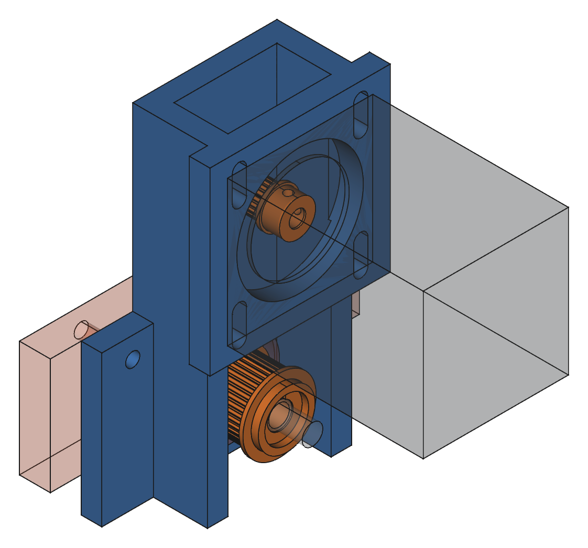
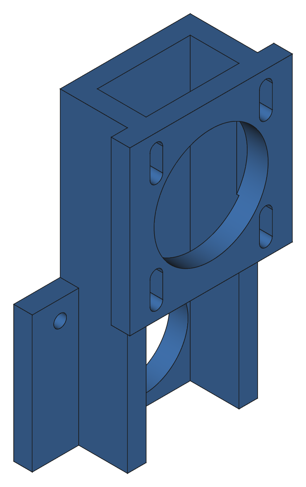

# X-axis belt drive

A NEMA 23 driving the **stock** X lead screw through a 2:1 GT2 belt, bolted to
the mill's existing X-axis bearing-seat plate. Nothing on the machine is
modified or drilled: the 40T pulley takes the place of the dial and handwheel
on the screw's existing keyed stub, and the bracket is clamped by the same two
M5s that already hold the plate on - just longer ones.



| | |
|---|---|
| Reduction | 2:1 (40T screw / 20T motor), from `machine/wen33013.toml` |
| Belt | 2GT, 15 mm wide, 200 mm closed loop (100T) |
| Centre distance | 69.71 mm, motor directly above the screw |
| Bracket | 37 × 96 × 129 mm, 131 cm³ |

## The screw end it fits

Measured 2026-11-19, and corroborated by the WEN parts list in three places:

```
   |<-- 18.8 -->|<-- 13.0 -->|
   |   d10 land  |  M8 thread |
   +=============+~~~~~~~~~~~~+
   ^ 4 x 4 x 16 key, standing 1.5 proud
   ^ runs in an 8200 thrust bearing (10 x 26 x 11) in the cast seat
```

- `#13 Ball Bearing, 8200` → a **10 mm** bore, matching the Ø10 land.
- `#14 Washer, M8` + `#15 Nut, M8` → the thread beyond it.
- `#2-1 Key, 4 × 16` → a 4 × 4 key sunk 2.5 mm in a Ø10 shaft stands 1.5 proud.

## How it is held on

The bore runs 19.3 mm deep - 0.5 past the end of the Ø10 land - so the nut
recess bottoms on the *thread*, not on the shaft's own shoulder. The stock M8
washer and nut then clamp the pulley back against the bearing seat exactly the
way they clamped the handwheel. Washer and nut finish at 27.4 mm with 4.4 mm
of thread to spare.

There is **no grub screw**: the hub boss wall is only 2.5 mm, and putting one
through the belt seat would chew up three teeth. Torque goes through the key,
the nut holds it on. Use a nyloc or a jam nut.

## What locates it

The bracket's **Ø38.15 register bore drops over the bearing boss**, not over
the bolts. Two M5s on one horizontal line cannot resist the motor hanging
outboard - that couple has no lever arm between them - so the boss takes it
and sets the pulleys concentric at the same time.

The motor sits directly above the screw so belt tension acts straight down
through the bolt pattern's vertical centreline: pure shear on the M5s rather
than a moment.



## Bill of materials

| Qty | Item | Note |
|---|---|---|
| 1 | 40T GT2 pulley, 15 mm, Ø10 bore, 4 mm keyway | `stl/Pulley_40T.stl` - make it |
| 1 | Bracket | `stl/Bracket.stl` - make it |
| 1 | 20T GT2 pulley, 15 mm, **6.35 mm bore**, hubbed | buy |
| 1 | 2GT closed loop, 15 mm wide, 200 mm / 100T | buy |
| 1 | NEMA 23, 6.35 mm shaft ≥ 21 mm | buy |
| 2 | M5 × 30 socket cap | replaces the stock M5 × 15 |
| 4 | M5 for the motor | ±5 mm tension slots |
| 1 | M8 nut + washer | **reuse the stock ones** off the handwheel |

## Before you cut metal

Four dimensions in `params.py` are still `ASSUMED`:

| Param | Guess | Measure |
|---|---|---|
| `BOSS_D` | 38.0 | OD of the round bearing boss - this is the register fit |
| `BOSS_PROUD` | 10.0 | how far it stands off the plate face |
| `LAND_START_X` | 10.0 | plate face → shoulder where the Ø10 land starts |
| `PLATE_TOP_ABOVE` | 34.5 | bolt centres → top edge of the plate |

`BOSS_D` and `LAND_START_X` are the ones that matter: the first sets the
register fit, the second shifts the entire axial stack including the belt
plane. Change them and re-run the build loop.

## A different belt

Centre distance follows the belt. `BELT_TEETH` in `params.py` is the only
thing to change:

| Belt | Centre distance | Bracket height |
|---|---|---|
| 140 mm / 70T | 39.5 mm | shortest |
| 160 mm / 80T | 49.6 mm | −20 mm on the tower |
| **200 mm / 100T** | **69.7 mm** | as drawn, shortest commonly stocked in 15 mm |
| 240 mm / 120T | 89.8 mm | +20 mm |

## Known concerns

- The screw runs in a **single 8200 thrust bearing**, which is not a radial
  bearing, and this hangs an overhung pulley with belt side-load on it.
  Tension only as much as it needs - it is a lead screw, not a printer axis.
- `screw_pitch_mm` for X is **PROVISIONAL** in the TOML. Until the stock
  screw's lead is measured, every X scale and feed derived from it is a guess.
