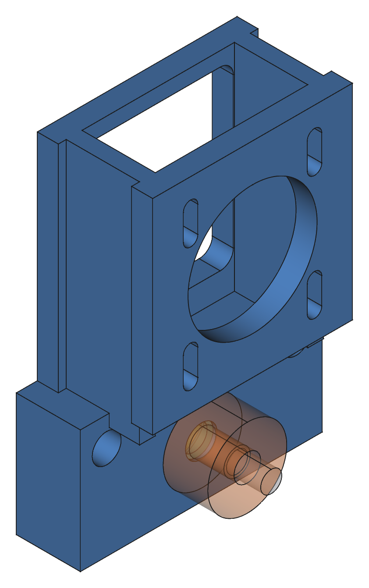

# X end housing

Replaces the stock X-axis bearing seat. Bolts to the **same two M6 holes** in
the table casting and supports the screw on a **preloaded pair of 6000-2RS**
instead of one single-direction thrust bearing. See
[ADR-0010](../../../docs/decisions/0010-x-end-housing-replaces-the-stock-plate.md).



```bash
cd hardware/mechanical/x-end
FreeCADCmd build.py      # -> wen_x_end.FCStd  (a build artefact, gitignored)
FreeCADCmd export.py     # -> stl/Housing.stl + the two spacers
```

`stl/Housing.stl` is the thing to print. **The two spacers are exported for
reference and a dry fit only** - they carry the M8 nut's clamping preload and
printed plastic will creep under it, taking the bearing preload with it.
Turn them from steel or brass.

## Why

The stock screw is located axially by one 8200 thrust bearing, preloaded by
the handwheel nut. **That preload is the X backlash**, and it is set by how
hard someone did a nut up. A preloaded pair takes both axial directions and
all the radial load together.

## The budget, and why it is the whole design

Origin: `X = 0` at the **table's end face** - the machined face the stock
plate bolts to. Note this is *not* the x-drive origin, which sits on the
stock plate's outer face, 12 mm further out.

Only **38 mm** of Ø10 land is outboard of that face. Everything lives in it:

```
  -16        0                                   25.4        38        51
   |  inner  | lip  brg1  spacer  brg2  clip web |  pulley   | thread  |
   |  spacer |                                   |           | nut ->50
   shoulder  table face                     housing ends   washer sits here
```

That 38 is **derived from three caliper readings**, none of them guesses:

| | |
|---|---|
| stock plate thickness | 12.0 |
| boss standing proud of the plate face | 16.0 |
| free keyed land beyond the stock stack | 10.0 |
| **land outboard of the table face** | **38.0** |

Cross-checked against the whole land measured off a ChArUco frame at
0.044 mm reprojection: **54 mm** shoulder-to-thread, self-calibrated two ways
(the shaft reads Ø10.07 across against a caliper 10.00; the thread reads 13.5
along against 12.99). 54 − 38 = 16 mm of shoulder inside the casting, which
is exactly how deep the stock bearing pocket is. Two routes, one answer.

## The constraint that sets everything

An M8 washer's ~8.4 bore **cannot pass over the Ø10 land**. So the pulley's
outboard face must *reach* the thread at 38, and the nut must still have
thread under it, so that face cannot go much past 41.9. Lip, two bearings,
spacer, circlip, web and the pulley's own width all fit in that window.

**The spacer is what is left over, not a choice.** `params.py` solves it and
refuses to build if it comes out under 3 mm:

```
pulley width   17.0 MEASURED; this housing takes up to 17.6
spacer          3.6, solved
bearings        2.0..10.0 and 13.6..21.6, centres 11.6 apart
pulley         24.9..41.9     nut ends 50.0 of 51.0 -> 1.0 spare
```

The pulley in hand is **17.0 and it fits, with 0.6 mm to spare.** It is a
40T: ~25 mm over the tooth tips, and a 40T GT2 is 24.957 where a 38T is
23.68 and a 42T 26.23, so the count is not in doubt. Anything wider than
17.6 would leave no spacer to preload across.

## One bore, one diameter

The 6000-2RS (10 × 26 × 8) and the stock 8200 thrust bearing (10 × 26 × 11)
share a **26 mm OD**. So the housing is a single Ø26 bore at a single depth,
and the stock thrust bearing stays a drop-in option in the same pocket if the
preloaded pair ever proves not stiff enough.

Retained by a seat at the inboard end (Ø20 × 2) and a DIN 472 circlip at the
outboard. The inboard end cannot be closed by the table face itself, because
the casting has the old bearing pocket there - which is also why the inner
spacer has to bridge 18 mm back to the shoulder.

## Printing

Print the **inboard face flat on the bed**, building up in +X. The Ø26 bore
then prints as a vertical cylinder - round, no support - and the only
overhang is the motor plate's underside, which bridges between the two side
walls. That face is not functional; the motor seats on the other side of the
plate. Supports off.

### What the slicer will flag, and what to do about it

Printed inboard-face-down there is **one** thing genuinely in the air: the
motor plate's underside, bridging 58 mm between the side walls. Leave
supports off. It is a two-sided bridge, the face is not functional - the
motor seats on the other side of the plate - and the only thing sag would
hurt is the belt, which runs 3.0 mm below it and is asserted.

```
overhang   2315.5 mm2 at X= 35.90  the motor plate bridge, expected
overhang    234.0 mm2 at X= 35.90  the motor plate bridge, expected
overhang    234.0 mm2 at X= 35.90  the motor plate bridge, expected
overhang    200.9 mm2 at X= 22.90  stray
```

The two 234s are the plate overhanging the walls by 3 mm; the 201 is the
annulus backing the circlip. `build.py` audits this on every build and fails
if anything that is *not* the plate bridge exceeds 300 mm². An earlier
version put a Ø12 hole under the Ø27.2 circlip groove, which left **7.6 mm
of annulus overhanging inward all the way round** - printable, but the
slicer was right to object. It is Ø22 now, which a DIN 472 ring still backs
completely because the ring stands proud to about Ø24.

**Perimeters, not infill.** The sections that carry load here are thin: 7 mm
of wall between the bore and the bottom face, a 2 mm lip under the first
bearing, and 12 mm of counterbore floor under each bolt. Perimeters are solid
extrusion; infill is not.

| | |
|---|---|
| Perimeters | **5-6** (2.0-2.4 mm at a 0.4 nozzle) |
| Top / bottom layers | **5-6** - the lip and the counterbore floors are top surfaces in this orientation |
| Infill | **40-50%**, gyroid or grid. Below ~25% the block round the bore goes spongy; above ~50% buys little |
| Material | **PETG or ASA, not PLA.** PLA creeps under sustained bolt load |

Nothing here is highly stressed - the bearings see about 130 N against a
4.5 kN rating, and the M8 nut's preload closes through the *shaft*, not
through this part. The failure modes are creep and bore fit, not fracture.

### The M6 washers are not optional

The counterbores are Ø14 so a standard M6 washer sits under each head. A
Ø10 cap head straight on plastic is ~45 mm² of bearing area; this joint wants
roughly 500 N a bolt to hold against belt pull and cutting load, which is
11 MPa of sustained compression. PETG creeps under that and the clamp goes
slack over weeks. With the washer it is 5.6 MPa.

Don't torque them to an M6 spec either - the aim is a firm clamp, not a
fastener at its own limit.

### Check the bore before printing the whole thing

```bash
FreeCADCmd build.py      # -> stl/BoreGauge.stl, 27 cm3
```

A printed Ø26 bore will not come out at 26.00, and the housing is 167 cm³.
The coupon is the housing's **own first 14 mm** - an intersection with a
slab, so it cannot drift from the part it is checking - carrying the lip and
the start of the bore.

Press a 6000-2RS in. You want it snug, seating with hand pressure or a light
tap, not hammered and not loose. If it is wrong, change `BORE_FIT` in
`params.py` and print the coupon again - it is minutes, not hours.

`BORE_FIT` is 0.05, which is a *machining* allowance. A printed bore usually
wants more like 0.2-0.3 to land in the same place. Tune it on the coupon.

## Bill of materials

| Qty | Item | Note |
|---|---|---|
| 1 | Housing | `build.py` |
| 2 | 6000-2RS, 10 × 26 × 8 | you have a stack of them |
| 1 | Inner spacer, Ø16 × Ø10.1 × 18 | turned; bridges the casting pocket |
| 1 | Outer spacer, Ø24 × Ø19 × 4.6 | sets the preload span |
| 1 | Circlip, DIN 472, 26 mm bore | |
| 2 | **M6 × 25** socket cap | replaces the stock M6 × 16 |
| 2 | M6 washer | **required** - see Printing |
| 1 | 40T GT2, 10 mm bore, 6 mm belt, 17.0 wide | **yours** - grub screw into the keyway |
| 1 | 20T GT2, **8 mm bore**, 6 mm belt, hubbed | buy - your 10 mm bore will not fit an 8 mm shaft |
| 1 | 2GT closed loop, **6 mm** wide, 200 mm / 100T | buy |
| 1 | NEMA 23, 8 mm shaft | |
| 1 | M8 nut + washer | reuse the stock ones |

The key comes **out**: it stands 1.5 proud and a plain Ø10 bore will not pass
over it. Grub screw into the empty slot, second at 90°.

## The motor tower

One part, not two: the bearing block carries a back web, two side walls and
the motor plate, with the NEMA 23 straight above the screw so belt tension is
pure shear through the M6s rather than a moment.

```
centre distance   69.71 on a 100T belt, motor straight above
belt plane        X 25.9..32.9, 3.0 clear under the motor plate
walls start       Z 22.0, above the M6 heads at 15.7
whole part        43.9 x 92 x 128.7, 167 cm3
```

Two rules carried over from the x-drive bracket, both learned the hard way:

- **Every screw has to be reachable.** The motor's four go into blind holes
  so they can only enter from inboard - the window in the back web is the
  convex hull of their four corridors. The M6s are driven from outboard down
  their counterbores, which is why the side walls start at Z = 22, above
  their heads. `build.py` probes all six, at every slot extreme.
- **The motor plate's underside is a bridge over the belt.** It clears by
  3.0 mm, and that gap is asserted.

## Still open

1. **A 20T with an 8 mm bore.** The motor shafts measure 8 mm, so the 10 mm
   bore pulleys fit the *screw* but not the motor. This one has to be bought.
2. **Where the teeth sit in the screw pulley's 17 mm.** Assumed flange 1 /
   teeth 7 / flange 1 / hub 8 with the hub outboard. If it is the other way
   round the belt plane moves 8 mm, and the motor pulley just slides along
   its shaft to match - the grub screws make this a non-problem in practice.
